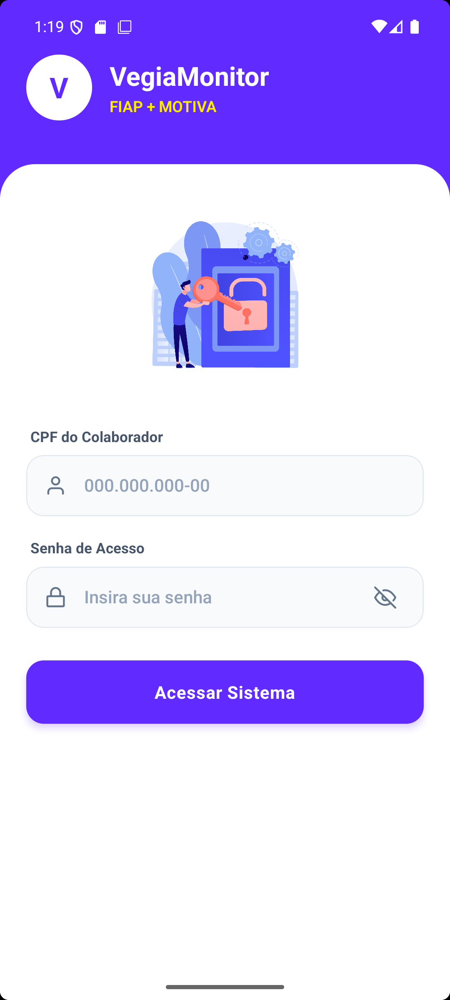
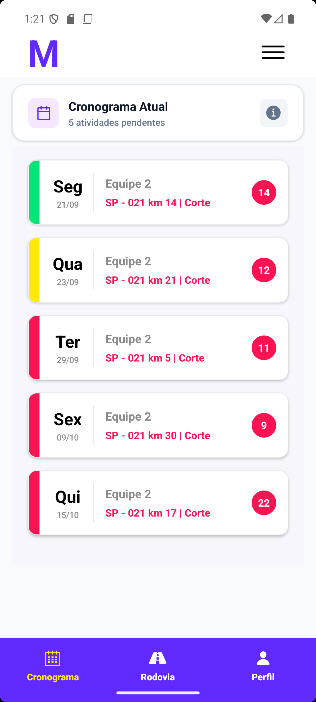
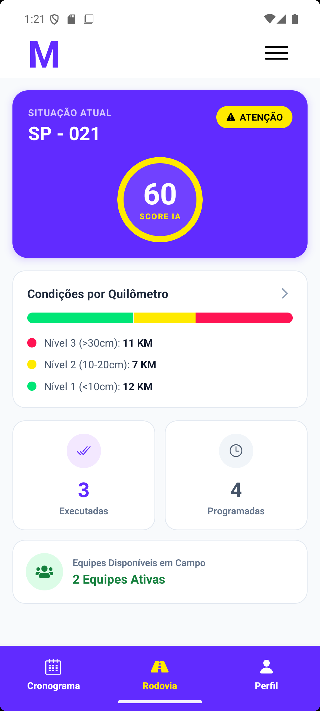
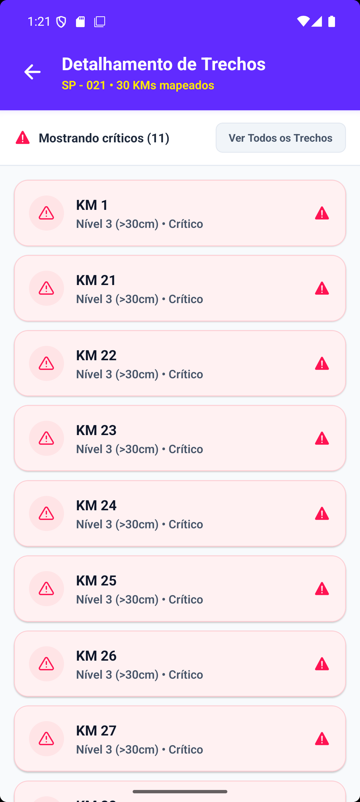
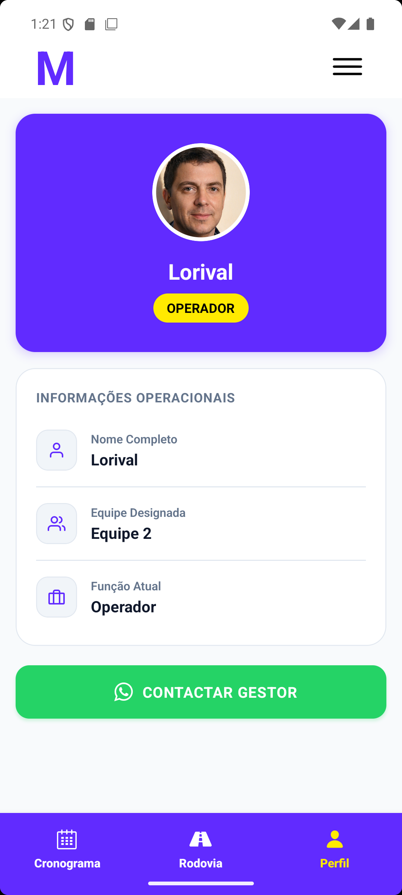
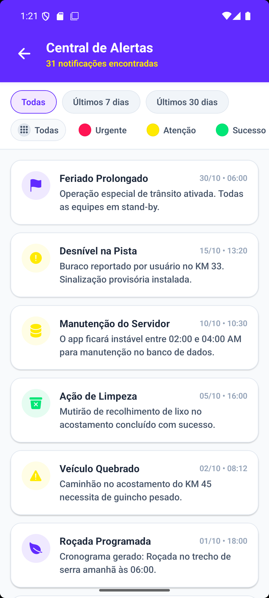

# 🌿 VegiaMonitor — Monitoramento Preditivo e Operacional de Vegetação Rodoviária

> **Projeto desenvolvido em parceria FIAP + Motiva**
>
> **Sprint 4 — Versão Final, APK de Produção e Plano de Negócio**

## 📌 Links Rápidos e Entregáveis Finais

* 📱 [**Download do APK Final (Android)**](https://github.com/EduardoAbreu01/vegiamonitormobile/releases) *(Ou link equivalente)*
* 🎥 [**Vídeo de Pitch e Demonstração Final (YouTube)**](https://www.youtube.com/watch?v=RioUBZpXpA8)
* 🎨 [**Protótipo Navegável de Alta Fidelidade (Figma)**](https://www.figma.com/proto/e7N028hcvrNlGwY91rd7N2/Prot%C3%B3tipo-Vegia-Monitor-Mobile?node-id=2-2&p=f&t=ExTvm6irflxRztrv-1&scaling=scale-down&content-scaling=fixed&page-id=0%3A1&starting-point-node-id=2%3A2)
* 🌐 [**Serviço Backend API (REST)**](https://vegiamonitor-backend.onrender.com)

---

## 👥 Integrantes do Grupo
* **Eduardo Abreu**
* **Gabriel De Biasi Couto**
* **Gabriel dos Anjos**
* **João Pedro da Silva Costa**
* **João Pedro de Souza Ferreira**
* **Rodrigo Campos Cordeiro**

---

## 🚀 Resumo de Evolução por Sprint

```
[ Sprint 1 ] ────────► [ Sprint 2 ] ────────► [ Sprint 3 ] ────────► [ Sprint 4 ]
 Requisitos            App React Native       Fluxos Completos,      API RESTful,
 Funcionais/RNF &      com Mocks JSON &       Estados de Exceção     AsyncStorage,
 Arquitetura           Bottom Tabs            & Testes Manuais       APK & Business Plan
```

* **Sprint 1 (Levantamento de Requisitos & Arquitetura):** Mapeamento detalhado dos Requisitos Funcionais (RF) — autenticação por credencial, cronograma com trecho por KM, dashboard da rodovia com score e gráficos de nível da grama, central de notificações e contato rápido com gestor via WhatsApp — e Requisitos Não-Funcionais (RNF) focados em usabilidade externa sob luz do sol, compatibilidade com Android antigo e suporte à operação offline.
* **Sprint 2 (Desenvolvimento do App Funcional com Mocks):** Construção da estrutura mobile em React Native/Expo com navegação por Bottom Tabs, aplicação do Design System de alto contraste e criação da camada de Mocks JSON locais (`usuarios.json`, `rodovias.json`, `rocadas.json`, `notificacoes.json`) para simular cenários reais da operação da Concessionária Motiva.
* **Sprint 3 (Protótipo Funcional Completo & Validação de Testes):** Consolidação de 100% dos fluxos navegáveis (sem telas incompletas ou travamentos), evolução dos mocks para cobrir estados de erro, listas vazias e casos alternativos, e execução do Plano de Testes Manuais (`TESTES.md`) cobrindo os 5+ fluxos principais para identificação de pendências antes da entrega final.
* **Sprint 4 (Integração Backend, Offline-First, APK & Plano de Negócio):** Substituição integral dos dados simulados por consumo da **API RESTful** hospedada na nuvem, implementação de persistência local resiliente via **`AsyncStorage`** para tolerância a falhas de conexão no campo, geração do **APK de Produção**, elaboração do **Plano de Negócio Executivo** e gravação do **Vídeo de Pitch Final**.

---

## 🟢 Status Atualizado das Funcionalidades (Sprint 4)

| Funcionalidade | Descrição | Integração / Persistência | Status |
| :--- | :--- | :--- | :---: |
| **Autenticação de Operadores** | Validação de credenciais (CPF e Senha) no backend central com tratamento de erros HTTP. | API REST + `AsyncStorage` | 🟢 **Concluído** |
| **Persistência de Sessão** | Manutenção do estado autenticado do operador mesmo ao fechar e reabrir o aplicativo. | `AsyncStorage` | 🟢 **Concluído** |
| **Dashboard da Rodovia (IA)** | Exibição do Score Geral de Conservação e gráfico linear por altura de grama (Níveis 1, 2 e 3). | API REST (`/rodovias`) | 🟢 **Concluído** |
| **Cronograma Operacional** | Lista de ordens de serviço e roteiro do dia (KM inicial e final) filtrados por equipe. | API REST + Cache `AsyncStorage` | 🟢 **Concluído** |
| **Estratégia Offline-First** | Armazenamento temporário e cache do cronograma para consulta em áreas de sombra de sinal. | `AsyncStorage` | 🟢 **Concluído** |
| **Central de Alertas & Notificações** | Listagem de avisos urgentes e informativos enviadas pela gestão com severidade visual. | API REST (`/notificacoes`) | 🟢 **Concluído** |
| **Perfil & Deep Link WhatsApp** | Exibição de dados e botão de ação rápida "Contactar Gestor" via Deep Link nativo (`Linking`). | Deep Linking Nativo (`Linking`) | 🟢 **Concluído** |

---

## ⚡ Arquitetura de Integração: API Backend & AsyncStorage

Nesta versão final (Sprint 4), a camada de dados simulados locais foi inteiramente substituída por uma arquitetura resiliente:

```
                  ┌─────────────────────────────────────────┐
                  │    API Backend (Spring Boot)            │
                  │https://vegiamonitor-backend.onrender.com│
                  └────────────────────┬────────────────────┘
                                       │ (Requisições HTTP REST / JSON)
                                       ▼
┌─────────────────────────────────────────────────────────────────────────┐
│                        VegiaMonitor Mobile App                          │
│                                                                         │
│   ┌───────────────────────────┐         ┌───────────────────────────┐   │
│   │    Módulo `apiFetch`      │ ──────► │   Gestão de Estado Global │   │
│   │   (Handling HTTP/Errors)  │         │       (`AuthContext`)     │   │
│   └─────────────┬─────────────┘         └─────────────┬─────────────┘   │
│                 │                                     │                 │
│                 ▼                                     ▼                 │
│   ┌─────────────────────────────────────────────────────────────┐       │
│   │               Camada de Cache e Persistência                 │       │
│   │                   `AsyncStorage` Local                      │       │
│   └─────────────────────────────────────────────────────────────┘       │
└─────────────────────────────────────────────────────────────────────────┘
```
> ⚠️ **Observação sobre o Serviço no Render (Plano Gratuito):**  
> Como a API RESTful em **Java / Spring Boot** está hospedada na camada gratuita do Render (*Free Tier*), a aplicação entra em modo de inatividade  após períodos sem requisições. Por conta disso, **a primeira requisição (como a tentativa de Login inicial) pode levar entre 30 e 50 segundos para responder** enquanto o contêiner da API é inicializado na nuvem. Após esse aquecimento (*cold start*), a comunicação volta a responder de forma rápida e regular.

### 1. Consumo de API RESTful (`api.js`)
* O aplicativo conecta-se à API principal (`https://vegiamonitor-backend.onrender.com`), realizando requisições HTTP (`GET`, `POST`, `PUT`) para sincronizar a autenticação, a listagem de roçadas, os trechos das rodovias e os avisos operacionais.
* Foi desenvolvida uma camada centralizada `apiFetch` que trata cabeçalhos, requisições com timeout, tratamento de erros HTTP (401, 403, 500) e conversão de dados.

### 2. Persistência Local e Tolerância a Desconexão (`AsyncStorage`)
* Atendendo aos Requisitos Não-Funcionais estipulados na Sprint 1 para atuação em rodovias (áreas sem cobertura 3G/4G/5G):
  1. **Manutenção do Login:** Armazenamento do token de sessão para evitar logins repetidos no campo.
  2. **Cache de Consultas:** Armazenamento dos cronogramas e trechos em cache local no celular.
  3. **Tolerância a Falhas:** Exibição fluida dos dados locais cached sem travamentos na interface.

---

## ☀️ Design e Acessibilidade em Campo (Visibilidade sob Luz Solar)

Desenvolvido para atender rigorosamente ao requisito não-funcional de usabilidade sob iluminação solar direta:

* **Alto Contraste Visual:** Fundos claros de alta refletância (`#F8FAFC` e `#FFFFFF`) combinados com tipografia pesada (`fontWeight: 'bold'`) em tons escuros e profundos (`#0F172A`), garantindo legibilidade em campo.
* **Sinalização Saturada de Prazos:** Prazos e alertas utilizam blocos de alta saturação (Verde `#00E676`, Amarelo `#FFEA00` e Rosa/Vermelho Neon `#FF1453`).
* **Touch Targets Ampliados:** Botões e seletores possuem dimensões ampliadas (mínimo de 16px de padding) para facilitar a utilização por operadores vestindo luvas ou EPIs.

---

## 💼 Plano de Negócio Executivo (Business Plan)

### 1. Proposta de Valor
O **VegiaMonitor** substitui as vistorias manuais por um sistema inteligente de monitoramento preditivo de vegetação que combina **Visão Computacional** (câmeras de CFTV existentes) com uma **Arquitetura Híbrida de Calibração Física (*Ground Truth*)** por sensores a laser (ToF + ESP32) instalados pontualmente.
* **Previsibilidade:** Algoritmos preditivos que projetam a altura do mato para janelas de 7 e 14 dias.
* **Economia Operacional:** Redução de custos de mobilização de frentes de corte e otimização das rotas de roçada.

### 2. Público-Alvo e Personas
* **Concessionárias de Rodovias (Ex.: Grupo Motiva):** Gestores de conservação, diretores de operações e inovação.
* **Supervisores e Operadores de Campo:** Profissionais que atuam na rodovia e usam o app para consultar tarefas offline.
* **Órgãos Reguladores (ANTT / ARTESP):** Garantia de compliance com os indicadores contratuais de conservação viária.

### 3. Modelo de Receita
Modelo **B2B / SaaS (Software as a Service)** escalável:
* **Assinatura Recorrente SaaS:** Mensalidade proporcional à extensão monitorada (**R$ / km / mês**).
* **Taxa de Implantação (*Setup Fee*):** Cobrança pontual para integração com o CFTV existente e instalação dos nós IoT amostradores.
* **Serviços Adicionais (Add-ons):** Módulos preditivos avançados e relatórios de governança regulatória.

### 4. Estrutura de Custos
* **Infraestrutura Cloud & IA:** Servidores de inferência visual e hospedagem de banco de dados.
* **Hardware dos Nós IoT:** Custos reduzidos de montagem dos módulos amostradores (ESP32 + ToF).
* **Desenvolvimento e Suporte:** Manutenção do app, treinamento de equipes e garantia de SLA.

---

## 🛠️ Stack Tecnológica

* **Frontend Mobile:** React Native / Expo
* **Navegação:** React Navigation (Stack e Bottom Tabs)
* **Gerenciamento de Estado Global:** React Context API (`AuthContext`)
* **Persistência Local (Offline):** `@react-native-async-storage/async-storage`
* **Comunicação com Backend:** Fetch API / `apiFetch` (JSON RESTful)
* **Integrações Nativas:** Expo Linking (WhatsApp Deep Linking)
* **Backend de Produção:** Java / Spring Boot Hospedado em nuvem (Render)

---

## ⚙️ Instruções de Instalação e Execução

### Opção A: Instalação Direta no Celular (APK Final)
1. Baixe o arquivo `.apk` diretamente da [Release do Repositório](https://github.com/EduardoAbreu01/vegiamonitormobile/releases) em seu dispositivo Android.
2. Autorize a instalação de fontes desconhecidas nas configurações do Android e conclua a instalação.
3. Acesse o aplicativo **VegiaMonitor** com as credenciais cadastradas.

### Opção B: Execução em Ambiente de Desenvolvimento (Expo CLI)
1. Clone este repositório:
   ```bash
   git clone https://github.com/EduardoAbreu01/vegiamonitormobile.git
   cd vegiamonitormobile
   ```
2. Instale as dependências:
   ```bash
   npm install --legacy-peer-deps
   ```
3. Instale os módulos nativos de linking e storage:
   ```bash
   npx expo install @react-native-async-storage/async-storage expo-linking
   ```
4. Inicie o servidor de desenvolvimento:
   ```bash
   npx expo start
   ```
5. Escaneie o QR Code no terminal via aplicativo **Expo Go** em um celular ou pressione `a` para abrir no emulador Android.

---

## 🔐 Dados de Login

 ```bash
CPF: 32132132132
 Senha: 123456
```


## 📱 Demonstração Visual do Aplicativo

| Tela de Login (API REST) | Cronograma Operacional | Dashboard da Rodovia |
| :---: | :---: | :---: |
|  |  |  |
| *Autenticação segura via API* | *Lista de tarefas com cache offline* | *Score de conservação e IA* |

| Detalhamento por KM | Perfil & WhatsApp | Central de Alertas |
| :---: | :---: | :---: |
|  |  |  |
| *Visão segmentada da via* | *Atendimento via Deep Linking* | *Avisos operacionais em tempo real* |
